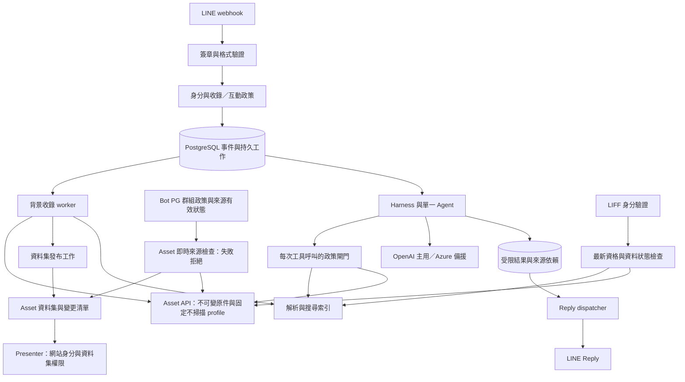

# LINE Bot with Harness 新專案完整計劃

版本：第二版整合稿（Asset 重構後接合、註冊與管理流程修訂）｜更新：2026-11-12｜狀態：政策已收斂，工程驗證尚未完成；未實作或部署。

本計劃可獨立用於建立新專案，將產品目標、專案結構、架構、資料設計及分階段驗收整合為一份文件。第一版原稿 `2026-11-08-line-agent-harness-original-plan.md` 保留不動；本版取代先前第二版的追加式編排。

本版已納入逐項確認後的最新產品決策；使用者授權剩餘常規細節採簡單設計，僅擴大開發範圍時再詢問。工程查證列在第十三節，不將政策定案當成能力已驗證。舊專案提供共用邊界與失敗案例的經驗；本輪已明確納入 Asset 與 HHC Presenter 媒體同步契約，不整套搬移舊業務功能、資料庫或框架。

本輪以「新 LINE 附件不掃毒、不預熱」為規劃基線，已完成 source 層接合分析；不表示 Asset 現在已有免掃描 LINE profile，也不授權停用其他來源的掃描服務。工程證據、API 增量與依序實作方案見[2026-11-12 完整接合分析](2026-11-12-line-agent-harness-asset-integration-analysis.md)。

已追加[三系統行為相容對抗分析](2026-11-12-line-presenter-adversarial-review.md)：以 fetched main 的既有 Presenter 行為為基準，修正單件失效誤撤整群、增量政策事件、離線期限、穩定識別與聚會輪詢邊界。新政策不等於舊行為完全不變，切換需要相容 client 與演練。

## 一、產品目標與範圍

### 1.1 完成標準

建立以 **OpenAI Agents SDK＋Responses API、單一 Agent** 為核心的群組資料助理。已啟用群組的目前成員，皆可在該群組找回收錄的原始資料，知道來源與版本依據；不需個人註冊或網站帳號。服務不跨群洩漏、不主動推播，故障與成本行為明確。

典型情境：成員未呼叫 Bot 就貼上附件，日後在原群組 @Bot，依發布者、時間、文字說明或可擷取內文找回原件。圖片未附可用文字時，不承諾能憑圖片內文找到，也不推測排班。

### 1.2 已確認原則

- 一般服務只在已啟用群組提供；不開放一般使用者私聊智能服務，也不建立個人資料庫。
- 網站目前全域 Admin 是唯一管理角色來源；LINE 身分沿用網站帳號綁定，每次受保護管理操作重新驗證。沒有 Bot 自建 Admin 名單、邀請碼或群組負責人。
- Admin 私聊僅供群組註冊與管理，不查群組聊天內容、不下載附件。Admin 要查內容也須回目標群組並驗證目前成員資格。
- 群組由 Admin 在群組發起、私聊設定、回群組確認並 Reply 公告後啟用。可由同一位 Admin 完成，不要求雙人覆核。
- 群組啟用後收錄所有成員的支援內容，不要求逐則呼叫；互動仍要求明確 @Bot 或本人授權按鈕。
- 新成員可查加入前仍有效的收錄資料；公告明示未來成員也可查。成員資格未知時拒絕搜尋、查看與結果領取，不用舊資格放行。
- 群組資料自發布起保存 90 天；暫停時停收停讀、期限照算；恢復不回補。群組不設每人或每群儲存配額，仍有單檔與處理安全上限。
- 同一個 Bot 共用一條媒體收錄流程與既有 Asset 原件服務；群組查詢與選擇啟用的 Presenter 同步共用原件，各自驗證使用資格，不互相授權。
- 原件與證據優先，不以摘要取代原件。不同群組及同群不同提問者的互動狀態隔離。
- OpenAI 主用，每月 US$500 硬上限；故障或額度不足可轉 Azure。Azure 每月 US$100 是維運告警門檻，超過仍繼續，不設月費硬上限。
- LINE Bot 不 Push、不主動通知、不定時發摘要；僅有效使用者互動的 Reply 可發訊息。營運告警走既有維運管道。
- 新 LINE 媒體不掃毒，保留格式、大小、checksum、不可變原件與隔離解析；明示未掃描，不宣稱病毒安全。按需 worker 不預熱、不依賴聚會時段；Asset 其他用途的掃描與預熱維持原政策。
- 不執行附件程式、巨集、外部連線或指令；不提供任意終端機、檔案系統、瀏覽器或電腦控制。

### 1.3 首次產品交付

| 類型          | 保存與找回                               | 可搜尋內容                                             |
| ------------- | ---------------------------------------- | ------------------------------------------------------ |
| 群組文字／URL | 保存原文、網址與明確上下文，不抓網頁     | 原文與語意索引                                         |
| 圖片          | 保存已驗證格式與完整性的原件，受保護下載 | 可取得的檔名、發布者、時間、明確伴隨文字；不 OCR       |
| PDF           | 保存已驗證格式與完整性的原件             | 內建文字直接擷取；掃描頁不辨識                         |
| Excel         | 保存已驗證格式與完整性的原件             | 支援格式儲存格直接擷取，不計算巨集或外部連線           |
| 音訊／影片    | 保存已驗證格式與完整性的原件，受保護下載 | 可取得的檔名、發布者、時間、明確伴隨文字；不轉錄或辨識 |

保留原 Presenter 路徑已支援的 PDF／PPTX、圖片、音訊／影片及既有格式處理；PPTX 在 Bot 先按檔名／來源／明確說明找回，不新增內文解析。Excel 可保存找回，不代表新增 Presenter 投影器。

包含群組註冊、無模型基本搜尋、語意搜尋、版本候選、追問、長任務領取、附件說明預覽／確認、本人資料刪除、Admin 自然語言及確定性管理、撤回與生命週期。

不納入個人記憶／邀請註冊、群組負責人、跨群內容搜尋、歷史回補、OCR／媒體辨識、多智能體、主動提醒及寄信／日曆操作。已納入選擇啟用的 HHC Presenter 媒體同步、必要 website／Presenter 接合修改；OneDrive MCP、獨立永久素材發布及其他舊業務功能仍在範圍外。新增這些能力須另外確認，不以「沿用建議」推定授權。

## 二、使用流程與介面樣式

採 LINE 對話為主，少量手機優先 LIFF 頁面處理受保護搜尋與下載。優先沿用既有網站綁定入口，不另做個人註冊或大型管理後台。

| 入口                | 內容與界線                                                                       |
| ------------------- | -------------------------------------------------------------------------------- |
| 群組 @Bot           | 目前成員搜尋、追問、本人資料刪除；不要求個人註冊                                 |
| 群組結果            | 名稱、有限來源、時間、可確認版本依據、需驗證資格的查看／下載入口；不直接貼回原件 |
| 群組基本搜尋        | 由 @Bot 或本人按鈕開啟，可按關鍵字、發布者、日期、類型搜尋，不呼叫模型           |
| 原件查看頁          | 每次驗證目前群組成員與資料狀態；無權時不顯示內容或來源細節                       |
| Admin 私聊          | 已註冊群組狀態、去敏失敗原因、用量、註冊設定與管理預覽；不搜尋內容或下載附件     |
| Admin 管理選單      | 不依賴模型，支援狀態、啟用、暫停、恢復、刪除；與自然語言管理共用後端契約         |
| 未綁定者私聊        | 僅固定網站帳號綁定入口，不啟動智能服務                                           |
| 已綁定非 Admin 私聊 | 固定告知私聊僅供管理，不提供資料保存或查詢                                       |
| 工作結果按鈕        | 限本人／來源，顯示等待、完成、失敗、過期；重按不重跑工作                         |

基本搜尋限由原群組授權互動取得的範圍，不能由私聊任選群組查內容；Admin 可在私聊列群組管理 metadata，但不因此取得內容讀取權。

介面用繁體中文短句，一個畫面一個主要動作；狀態不只靠顏色。保留可讀標籤、鍵盤與行動適配。需確認的變更均顯示完整目標及影響；普通搜尋不加確認。精細視覺稿不是目前範圍。

普通查詢以 webhook 收到後 5 秒內送出最終或等待 Reply 為目標，包含排隊時間；不是裝置顯示 SLA。超時提供查看結果按鈕，不推播完成通知。未 @Bot 的群組附件保存失敗保持安靜，僅記錄原因供後續查詢或 Admin 狀態檢視。

### 2.1 群組設定接續與媒體同步

Admin 從目標群組發起，系統保存群組與操作者，不要求手填群組 ID、複製綁定碼或再做第二次媒體綁定。已綁定 Admin 直接私聊接續；未綁定者先完成既有網站帳號綁定，再接回同一短效申請。綁定完成事件須先於私聊 Admin 閘門處理，避免未綁定者永遠無法完成；完成綁定不等於取得 Admin 或啟用群組。

私聊預覽採既定規則，不建立多頁可調設定精靈。可選擇啟用 Presenter 同步，選定單一目標資料集，顯示名稱、網站可存取對象與保存規則；首版沿用既有資料集與 ACL 管理，不加入多目的地路由。預設不分享給 Presenter，只有明確選定並在群組確認公告後生效。沒有適合資料集時由既有網站建立，再回同一申請接續。網站登入／返回保留不透明流程參照，但接續仍重驗本人、Admin、期限及目標版本，不信任連結攜帶的權限。

最後回目標群組 @Bot 確認啟用，產生五分鐘確認按鈕。尚未驗證可直接跳轉指定群組，因此保留手動回群組的完整操作方式。網站與 LINE 分別顯示「帳號已綁定」「群組待確認」「群組已啟用」「媒體同步待處理／可用／失敗」，不把設定完成當成原件已保存。逾期、角色撤銷、Bot 離群及權限衝突提供明確重試／重新預覽出口。

## 三、技術方向與專案結構

### 3.1 工程預設與取捨

**建議預設：TypeScript 模組化單體，一份程式庫，分別啟動 API／Reply dispatcher 與背景 worker。** 採 Fastify、OpenAI Agents SDK、PostgreSQL＋pgvector、既有 Asset API 管理的私有原件儲存；LIFF 使用小型 TypeScript 前端。使用 pnpm、鎖定依賴版本與受支援的 Node.js LTS。確切版本、部署平台及 Asset 接合契約於階段 0 記錄；不另建 Bot 專用 binary 儲存或掃描服務。

| 方案                                 | 取捨與決定                                               |
| ------------------------------------ | -------------------------------------------------------- |
| 單一程式庫、API 與 worker 分別執行   | 初期採用；清楚分離回覆期限與慢速處理，仍可共用型別與規則 |
| 每個領域獨立微服務                   | 暫不採用；增加跨服務一致性、部署及權限成本               |
| 由託管 Agent／MCP 承擔全部狀態與權限 | 不採用；LINE 身分、撤回、可靠收錄與 Reply 必須由應用掌握 |

PostgreSQL 持久工作表、唯一約束、租約與交易是工作真相。建議 API 保留一個輕量副本處理 webhook／來源政策及租約保護的 outbox dispatcher，背景 worker 不預熱、可縮至零。沿用 queue/scaler 加交易 outbox，只投遞 opaque job ID，由 queue 喚醒 worker；PG 仍裁定執行與去重。API 常駐不是聚會預熱，階段 0 驗證其成本、故障續送與 scaler 能力。不要新增泛用排程器；Redis 不是初期必需品。

中文全文基線採精確欄位＋經資料集驗證的字元／片語比對方案，語意搜尋再補同義詞；不能只啟用 PostgreSQL 預設全文搜尋就宣稱中文斷詞品質合格。階段 0 決定實際索引方式與查詢效能門檻。

### 3.2 建議目錄

```text
src/
  bootstrap/          API、worker 組裝與關閉
  transport/line/     原始簽章、事件解析、postback、Reply dispatcher
  transport/http/     LIFF API、驗證、受保護內容傳輸
  identity/           網站綁定／全域 Admin 接合、群組政策與成員資格
  ingestion/          事件接收、收錄決策、附件工作
  resources/          Asset 原件參照、解析、搜尋、版本與刪除
  media-sync/         群組至 Asset 資料集發布、同步狀態與撤銷
  harness/            單一 Agent、工具閘門、預算、對話、執行紀錄
  jobs/               持久工作、租約、重試、結果
  providers/          OpenAI、Azure、LINE、Account、Asset、文字解析連接
  persistence/        PostgreSQL 查詢與交易
  observability/      去敏指標與錯誤
web/                  LIFF 設定、基本搜尋、原件查看；沿用網站綁定
migrations/           版本化 schema 與索引遷移
tests/                單元、契約、資料庫整合、離線評估、實機清單
docs/                 設計、決策、維運與驗收證據
```

目錄是責任指引，隨垂直功能建立，不先產生所有空資料夾或介面。依功能責任組織，不建立泛用外掛框架、第二個語意路由器或大量空介面。Transport 只呼叫應用操作；資料規則不依賴 LINE payload 或 SDK 狀態格式。只有外部系統、持久儲存及模型邊界需要可替換介面；composition root 負責組裝。API 與 worker 各自取得最少必要憑證。

### 3.3 架構與責任



SDK 在本應用執行工具循環；應用持有工具、儲存與核准責任，符合官方 SDK 路線。[OpenAI Agents SDK](https://developers.openai.com/api/docs/guides/agents/sdk)

Harness 不等於任意電腦代理：僅暴露第八節的群組資料工具與已核准管理／修改提案。收錄、授權、確認執行與來源失效採確定性流程；模型只理解需求、選工具及依證據回答。

## 四、身分、群組啟用與授權

### 4.1 唯一管理角色與身分綁定

沿用網站帳號與 LINE 身分綁定，網站目前全域 Admin 是唯一管理權威。綁定後取得網站角色即可管理，不需 Bot 再核准；角色移除即失效，不把目前可能只有三位寫成固定名單或人數限制。不設群組負責人、委派或邀請碼。

未綁定者只取得固定綁定入口；網站綁定流程的完成回調不得自行授予 Admin。後端驗證 token、channel／audience、期限及流程狀態，不相信前端自報 user ID 或顯示名稱。一般群組使用者透過 LINE 可信身分及目前群組資格即可使用，不要求網站綁定。LIFF 僅用來確認存取者身分，不建立新的服務註冊制度。[LIFF 使用者資料](https://developers.line.biz/en/docs/liff/using-user-profile/)

每次受保護 Admin 操作、草稿接續、預覽、確認與管理結果領取，都重新檢查網站全域 Admin；查詢失敗拒絕管理，不用舊角色放行。網站 Admin 依賴故障不連帶停掉一般群組服務；群組政策、目前成員資格與必要儲存可確認時照常收錄／查詢。被動收錄採群組政策及已驗證 LINE 事件，不為每則訊息查網站角色。

網站登入／MFA、LINE 綁定、網站角色、群組成員與服務身分是五個不同檢查，任何一個不能代替其餘檢查：

| 入口／用途                   | 身分與授權權威                                                    | 不授予的權限                         |
| ---------------------------- | ----------------------------------------------------------------- | ------------------------------------ |
| account-fe 登入與 MFA        | Account 網站 session；綁定須另外走 signed LINE challenge/finalize | 不自動成為 Admin、群員或已啟用群組   |
| Admin 私聊／管理頁           | 當前 active Account＋全域 role admin；LINE 入口另驗綁定           | 不授予群組內容或附件讀取             |
| 一般群組／LIFF 內容入口      | 可信 LINE 主體＋目前群員＋來源政策                                | 不要求網站帳號，不提供網站管理權     |
| Presenter 內容入口           | 當前 Account 主體／角色＋資料集 ACL＋精確來源政策                 | 不要求 LINE 群員，不提供群組聊天搜尋 |
| Bot／Asset／Gateway 私有 API | 各服務專屬已驗 caller、audience 與 endpoint scope                 | 不代表真人 Admin、群員或任意資料存取 |

Account 必須提供最小 verified-admin context：可信 Account actor、active/admin 判斷及 LINE binding generation；不是只回 bound/allowed。草稿與批准綁定 LINE＋Account＋binding generation，解除／重綁、切換網站帳號或觀測到角色失效即作廢舊確認，重新取得角色不恢復舊批准。為偵測兩次查詢之間移除又加回角色，context 必須含單調管理授權 revision，並在所有會改變此使用者管理資格的角色／狀態異動路徑與mutation同交易遞增；以此版本綁定批准，不靠快取猜測。

網站可準備草稿；需回群組公告的操作，最後仍須同一 Account actor 的已綁 LINE 身分及目前群員資格。未綁定／不在群時顯示缺少條件；其他 Admin 接手須建立自己的預覽與確認，不繼承他人批准。已允許從網站執行的暫停、撤銷等縮權操作不強迫改走 LINE。

### 4.2 群組註冊與告知

Admin 在目標群組 @Bot 發起 → 有限 bootstrap（未綁定時只保留短效申請並給綁定入口）→ 私聊／網站完成 Account 綁定 → 即時驗證 Admin → 私聊設定可選資料集 → 回目標群組重驗 Admin、目前成員與目的地／ACL revision → 預覽／明確確認 → Reply 公告 → 啟用。未驗 Admin 不可提交；綁定完成 challenge 必須在一般 Admin gate 前處理。

不主動私訊 Admin、不手填群組 ID、不因轉傳申請連結而取得管理權。各步驟重新查網站 Admin；同一位可完成全程，無第二位覆核。工程預設申請保存 30 分鐘，最後確認另以 5 分鐘一次性按鈕處理，過期可重開，不靜默恢復舊政策。

申請記錄 channel／group／LINE actor／可信 Account actor、設定 revision、目的地及 ACL revision；Account 若未提供管理 actor ID，補最小 verified-admin context，不從前端自報取得。目的地、角色、規則或 ACL 變更即要求重新預覽。現有 `/registry` 與 `/media-sync` 雙碼流程不帶入新專案。首版一個資料集只對應一個群組，以持久唯一保留與 binding generation 防止並行搶綁；存在其他群組有效資料或未釐清發布時不可重綁，不加入跨群共用資料集協調。

公告包括全體成員內容收錄、未來成員可查過往有效資料、90 天保存、不掃毒與格式／不辨識限制、OpenAI／Azure 處理、刪除與停用、Admin 管理方式及不推播。若啟用 Presenter，同時公告媒體會供資料集授權對象使用、可下載至裝置、沿用原期限且已下載副本無法保證收回。Admin 維護固定公告，不為新成員發自動訊息。

告知 Reply 成功且狀態提交後才 active；交付不明或成功後提交失敗維持待確認，需新的群組互動，不猜測告知完成。保存確認者、規則版本、公告交付紀錄、啟用區間及世代，不回補啟用前內容。

管理變更使用單一持久 operation ID 與預期版本。Asset 的 ACL／目的地提交須以 expected revision 條件寫入並可按 operation ID 核對，不能只在公告前讀一次版本。準備期間新分享不可讀；公告成功後仍須核對 Asset 的確切批准版本與本地設定才啟用。公告後發生版本衝突或外部結果未知，維持待處理並重新預覽，不默認成功、不重播舊 Reply。既有生效來源若 ACL 被未批准變更，其分享 gate 立即拒絕。縮權先使來源不可讀再清理；不持有資料庫鎖等待外部 API，也不建立通用分散式交易框架。

變更 Presenter 分享開關或目的資料集同樣預覽影響、重驗 Admin 與目標可管理權，並回目標群組確認公告；不靜默擴大受眾。啟用同步只處理生效後新收錄附件，不回補先前未分享素材。停用同步立即阻止該來源後續遠端存取與新同步，不停止仍已啟用的群組助理服務；重新開啟可恢復原先已分享且仍有效項目，不回補停用期間內容。換資料集先撤銷舊目的地發布，再讓新事件使用新目的地，不自動搬移歷史素材。

### 4.3 群組狀態與重新啟用

| 狀態           | 收錄與內容查閱                 | 恢復／處理                                                           |
| -------------- | ------------------------------ | -------------------------------------------------------------------- |
| 待啟用         | 關閉                           | Admin 完成設定、群組確認公告                                         |
| 已啟用         | 目前成員可用                   | 正常服務                                                             |
| 已暫停         | 同時關閉，90 天期限照算        | 任一網站 Admin 在目標群組重驗角色／成員資格、確認並 Reply 公告後恢復 |
| Bot 已離群     | 關閉，資料依原期限保存         | 再加入須重新經 Admin 核准並告知；未過期舊資料可恢復查閱              |
| 刪除中／已刪除 | 立即關閉，清除資料，不自動恢復 | 再使用重新啟用公告；已刪資料不可恢復                                 |

恢復、重新加入與查閱均不延長原期限，也不回補未啟用、暫停或離群期間訊息。啟用區間與資料生命週期分開：政策世代可撤銷舊工作，但不能因普通暫停／恢復就永久刪除仍有效原件。恢復後可重新核准有效舊資料讀取、必要索引，以及啟用期間已可靠受理、尚未完成的原件保存與原先已批准發布；沿用來源、冪等鍵與原截止，先核對未知外部結果，不能接受停用期間事件。

### 4.4 授權矩陣

| 操作                   | 條件與範圍                                                                            |
| ---------------------- | ------------------------------------------------------------------------------------- |
| 被動收錄               | 群組 active、事件位於啟用區間、可信 LINE 來源、支援類型及單檔安全限制；不要求個人註冊 |
| 群組搜尋／領取／下載   | 可信本人、目前成員資格、原群組 active、資料有效；每次重驗，未知暫拒                   |
| 附件說明與本人資料刪除 | 在原群組，核對作者或當前 Admin；預覽、本人確認、版本檢查                              |
| 全域管理               | 任一網站目前全域 Admin 可管理所有已註冊群組，不限發起者；私聊只讀管理 metadata        |
| 整群或他人資料刪除     | Admin，明確範圍預覽與確認；選定資料不靠私聊內容搜尋，使用不透明操作識別／群組內選取   |

普通成員可刪自己發布的原件、索引及衍生結果，不能刪別人的；LINE 撤回直接失效，不再要求確認。Admin 在私聊可以操作管理目標，但不得載入訊息內容、檔名、附件預覽來繞過內容讀取邊界。需查看內容時回原群組驗證成員資格。

**成員驗證：** 每次搜尋、附件存取及結果領取確認當前群組資格；LINE 登入或舊互動不是永久證明。採已知 group/user 的 member profile 等經實測有效的方式，配合本地離群／停用政策，不用舊資格放行。無法確認時提示稍後重試。官方端點可用性與帳號實際行為仍須測試。[LINE 成員查詢](https://developers.line.biz/en/reference/messaging-api/nojs/#get-group-member-profile)

新成員可以查加入前的有效資料，因此不建加入時間歷史權限系統。群組原始資料可共用，但 checkpoint、按鈕與工作結果按提問者隔離。

### 4.5 共用原件、分開授權入口

- LINE 查詢與下載：可信 LINE 身分、目前群組成員、群組 active、來源有效，不要求網站帳號。
- Presenter：網站登入及資料集存取權，加上原群組允許分享、群組 active、來源有效與 Asset 已按核准 profile 完成驗證；不要求 Presenter 操作者同時是群組成員，也不授予其聊天搜尋權。
- Bot 管理：網站目前全域 Admin；設定目的地另驗 Asset 資料集管理權，不能推定全域 Admin 自動具有任意素材讀權。既有媒體管理 permission 不得反向授予 Bot 管理權。
- 共用來源狀態與期限是兩個入口的必要條件，不建立第二份可獨立延長的 Presenter 素材。Admin 私聊只能看設定與管理 metadata，素材檢視依各自入口授權。
- 所有遠端清單、變更清單、票券簽發與內容傳輸都必須檢查適用政策。現有 Asset 票券若只驗簽而不重驗來源，不符合本計劃；須補檢查，不能靠短效票券冒充立即撤銷。政策服務無法確認時拒絕相關讀取，不以非同步刪除完成與否決定是否放行。

### 4.6 管理操作閉環與舊網站防繞過

新來源的設定／管理只認目前網站 global Admin，不認舊的 presenter:line:manage。網站、LINE 自然語言與固定選單共用同一命令／預覽／確認契約，不另寫網站直通變更。管理資格不自動授予素材讀取權。

| 操作                   | 確認與執行方式                                                                     |
| ---------------------- | ---------------------------------------------------------------------------------- |
| 狀態／用量             | Admin 即時授權後只讀去敏 metadata；不載入群組原文／附件                            |
| 暫停                   | 私聊或網站預覽、本人一次確認；先提交停收停讀，Asset 即時來源檢查拒絕，再背景收斂   |
| 恢復／Bot 再加入       | 任一 Admin 必須在原群組重驗成員並確認公告，不回補、不延長                          |
| 分享開關／目的地變更   | 私聊／網站準備，回群組確認公告；預覽受眾與 ACL revision；換目標不搬歷史            |
| ACL 擴大受眾           | 網站選擇後先預覽差異，回原群組確認公告才生效；其他 legacy addAcl 入口同受後端 gate |
| ACL 撤銷               | Admin 預覽確認後立即停止新存取；不等五分鐘票券自然到期                             |
| 本人／Admin 刪除       | 依既定原群組／不透明管理目標確認；走共同來源刪除命令，原件、索引與同步項目共同失效 |
| 永久保留／延長期限     | 新來源不提供；舊 retentionExempt 與 1–365 天 API 也不得延後來源截止                |
| Presenter 移除本地同步 | 只移除該裝置連線及受管快取，不刪群組共用原件                                       |

資料集「停止分享」與「刪除來源」須在 UI 分清，禁止直接刪 Asset 留下可搜尋的假原件。普通群員仍不用網站帳號；Presenter 一般 reader 不需要 Admin 身分。角色型 ACL 明示受眾隨網站角色成員變更，下載重新查當前授權，不能使用票券中舊角色快照。

## 五、可靠接收與背景工作

### 5.1 接收交易

1. 以原始 bytes 驗證簽章，檢查 payload 大小及格式後才處理事件。
2. 分別判定收錄、互動與生命週期用途。未啟用群組不得持久保存聊天原文；必要去重與拒絕紀錄只留最少 metadata。
3. 在同一 PostgreSQL 交易建立事件 receipt、被允許的原文／附件 metadata，以及唯一工作；唯一鍵包含 channel／服務與 webhook event ID。
4. 成功提交才回 HTTP 2xx；資料庫故障不假裝接收成功。空事件探測合法時回應成功但不建立工作。
5. 同批部分事件已提交後發生失敗，可讓批次重送；各事件依唯一鍵復用，不重複收錄或重複扣業務額度。

只保證已持久接收事件可被本系統恢復，不保證 LINE 從未漏送。官方明確說明 webhook redelivery 不保證可靠送達；文字不能靠日後任意回抓補齊。[LINE 接收與重送](https://developers.line.biz/en/docs/messaging-api/receiving-messages/)

### 5.2 狀態與工作機制

分開保存 receipt 的接收狀態、job 的執行狀態、resource 的原件／索引狀態與 delivery 的回覆狀態，不能用一個「已處理」旗標代替。

工作狀態：queued → leased → completed；暫時失敗進 retry_wait；永久失敗進 failed；暫停／離群進 held（政策阻擋），撤回／刪除／到期才為 cancelled。租約有到期時間及單調遞增 fencing token；舊 worker 不可更新新租約的結果。工作到期按步驟恢復，不盲目重跑整個流程。

PG 工作表與 receipt 同交易；採 queue 喚醒縮到零的 worker 時，一併交易式保存 outbox，由可靠投遞器發送 opaque job ID，消費者仍以 PG 工作狀態為準。outbox dispatcher 本身須有受驗證的執行／喚醒方式，不形成另一個永遠睡著的待辦。不可把業務資料或模型 prompt 放進 queue scaler 或診斷訊息。

同提問者同來源的互動工作依持久接收順序串行；採跨程序有效的鎖／租約與提交版本檢查，不跨外部 API 等待持有長交易。撤回、離群及刪除先更新禁止讀取狀態，優先於一般收錄／查詢工作。

### 5.3 及時保存附件

「已入列」只代表接收成功，不能顯示「原件已保存」。附件擷取工作優先於文字擷取／embedding；隊列容量、最長排隊時間、下載期限、重試次數、單檔上限須在真實試用前有值。

下載為暫時錯誤時有限重試，LINE 內容已無法取得或超過期限時記錄永久失敗與已知缺漏，不假裝可搜尋。Bot 接收事件未必含顯示名稱；可另外取得時記錄取得時間，不能把晚查名稱宣稱為發文當下名稱。無法辨識發布者時顯示未知，不編造。

所有工作在領取及結果提交時檢查目前政策、scope generation、resource revision 與撤回狀態。下載途中撤回，可能已取得的暫存 bytes 必須清除；不得發布、解析、索引或提供舊世代結果。

### 5.4 單次收錄與資料集發布

以 channel／group／message 的穩定來源識別收錄一次，附件由按需 worker 下載並交 Asset 依新固定 profile 驗證與保存，不排掃描工作；群組找回與 Presenter 發布引用同一 Asset ID，不另下載或保存一份。Asset 擁有 binary／readiness／安全證據；新專案擁有來源、群組政策、索引與發布工作，Asset 資料集擁有目的項目與 ACL。共用原件不共用聊天 checkpoint 或搜尋授權。

原件保存、文字索引與資料集發布各自有狀態。Presenter 發布失敗不令已保存原件變成保存失敗，也不重跑下載、Agent 或 embedding。持久保存每次 Asset 建立與資料集發布的冪等鍵、外部 ID、來源 revision 和結果；逾時先以相同冪等鍵／外部查詢核對，無法確認則標記待處理，不盲目重建。來源失效與發布競爭時禁止重新可讀，晚到外部結果記錄後排入撤銷清理。

新增來源的資料集發布採最小兩步契約：持久 publication intent → Asset 以冪等鍵建立不可見 staged item → Bot 記錄外部 item ID 與有效批准 → 冪等 activate，產生可見 change revision。暫存項目不進公開列表或前推使用者 cursor。worker 可用限 owner／operation 的 metadata status API 核對未知結果，不回傳 bytes、不依賴一般讀取 gate，避免「尚未記錄 published 所以永遠無法核對」的死鎖。啟用前與內容讀取仍驗當前來源；activate 後回應遺失可同鍵核對。這是待新增的窄 Asset 契約，不宣稱既有 AddCollectionItem 已支援。

收錄與同步不經模型、不耗對話資格或模型預算、不發 Push。先沿用既有資料集變更清單與下載契約，適配已支援的媒體；Bot 可保存不代表 Presenter 可播放，未支援格式須明示，不新增伺服器轉檔或辨識管線；Presenter 已有 Electron VLC preparation／格式準備保持。新 Bot worker 不呼叫 Operations 活動時段、不保留 warm queue／cron warmer；Presenter 自己既有的聚會快速輪詢（meeting 2 秒、active 15 秒、idle 60 秒）與失敗 fallback 保留；移除預熱不等於免冷啟動，首次及突發附件等待須實測。不得順便停用其他 Asset 消費端的掃描或預熱。

## 六、資料模型與生命週期

### 6.1 邏輯資料責任

下表定義邏輯實體，實作可合併小型表，不要求一實體一服務。

| 實體                       | 最小資料與不變條件                                                                 | 保存／刪除責任                                         |
| -------------------------- | ---------------------------------------------------------------------------------- | ------------------------------------------------------ |
| Identity / AccountBinding  | 可信 LINE 主體、既有網站綁定參照；不存權威角色副本                                 | 網站全域 Admin 每次重新查；不設個人註冊表              |
| Scope / GroupPolicy        | 群組、啟用區間、狀態、政策與 generation；direct-admin 僅短期管理 context           | 不設群組負責人；政策世代與原件保存期限分開             |
| EventReceipt               | channel、event ID、scope、收到時間、處理狀態                                       | 期限覆蓋可接受重送窗口；不永久保留完整 webhook         |
| Message / Resource         | scope、message ID、發布者、發布／收到時間、原文／Asset ID、雜湊、revision          | 保存政策；同 scope/message 唯一；撤回不可復活          |
| Asset / Parse              | 原件狀態、MIME、大小、checksum、profile/readiness/安全證據、解析版本               | 隔離暫存；核准 profile 未完成或未知 readiness 不可對外 |
| MediaPublication           | resource、Asset ID、目標 collection/item ID、來源 revision、冪等鍵及發布／撤銷狀態 | 不延長原期限；失效先拒絕讀取再清理目的項目             |
| Chunk / Index              | resource revision、文字、embedding 模型／維度／版本                                | 來源依賴；失效即不可查，重建後原子切換                 |
| VersionRelation            | 兩個來源、關係、依據與信心                                                         | 不能只因相同標題或較新發布時間建立正式替代             |
| Job / Run / ToolCall       | scoped work ID、租約、step、呼叫序號、完成結果、失敗類型                           | 恢復及備援用；敏感結果有期限與存取控制                 |
| Conversation / Interaction | requester、scope、conversation generation、policy version、期限、nonce、消耗狀態   | 私有短期狀態；與群組原始資料分開                       |
| Result / Dependency        | 結果、來源 ID／revision、擁有者、期限                                              | 交付前逐一重查來源，不以保存結果繞過撤回               |
| Usage / Audit              | 預留與實耗、操作與結果、去敏關聯識別                                               | 成本與管理稽核；不保存原文或模型 payload               |
| Deletion / Tombstone       | scope、訊息識別、失效世代、刪除進度                                                | 保護晚到事件與備份還原；期限見 6.3                     |

授權範圍必須在候選查詢前套用，不可先全域搜尋再由模型過濾。內部 ID 可以用於後端關聯，模型只拿當次 scoped 候選 handle，不能將 handle 當成獨立授權。

### 6.2 原件處理與安全

原件保存與索引狀態分開：received → uploading／validating → ready／rejected；依核准不掃描 profile 完成格式與完整性驗證才 ready，仍須通過來源與存取授權才能提供，索引另外記 pending／ready／not_applicable／failed。文字直接索引；PDF／Excel 擷取支援內文，圖片／音訊／影片只索引 metadata 與明確說明。不因不支援辨識而永久停在 parsed 前。所有 binary 先驗證格式、大小、checksum，再以受限環境解析或經授權提供；ready 不等於病毒安全。

- 私有物件儲存沒有公開 ACL；物件鍵由後端產生，不接受使用者路徑。首版不跨訊息去重原件，只對同一事件冪等；同檔另行發布各有獨立 Asset／期限，解析結果可按 scope 與 checksum 重用；不因另一群已有相同檔案而洩漏其存在。
- 下載限制 bytes、時間、MIME／檔頭；檔名只作顯示。解析 worker 限 CPU、記憶體、解壓大小及頁數，不執行巨集、公式外部連線或附件腳本，不擁有任意網路存取能力。
- PDF 只直接擷取內建文字；Excel 讀支援格式儲存格。圖片、掃描式 PDF、音訊與影片不做 OCR、視覺辨識或轉錄。URL 只保存網址與明確聊天上下文，不抓網頁。只保留最小直接文字解析；不新增掃毒、OCR 或影音轉碼管線。
- Asset 與新專案 PG 無跨系統交易：先持久保存建立意圖與冪等鍵，再呼叫 Asset，保存外部 ID 後才發布來源參照。只有有效租約與來源 revision 可提交。Asset 管理不可變原件與 profile 驗證，Bot 不直接寫底層 blob；逾時依同鍵重試／查詢既有結果，未知結果保留待核對。刪除經 Asset 釋放本來源所擁有的參照與項目，實體回收由 Asset 確認無其他有效引用後執行，不可誤刪其他用途的檔案。
- 加密、損壞、過大、不支援及驗證失敗均有明確狀態。未掃描不冒充 scanned／clean；來源文檔不可信，文字擷取仍隔離、有限資源，不執行巨集或外連。

Presenter 同步項目與原件共同遵守來源期限；原群組暫停或 Bot 離群時，停止新同步與線上存取，恢復只開放先前已分享且未過期資料。撤回、刪除、到期與整群刪除同步使資料集來源不可讀，發送變更／tombstone 供客戶端收斂；不能以另一資料集入口繞過來源失效。不將群組聊天或搜尋索引同步進 Presenter。

Asset 現有 item.created_at + collection.retention_days 不能代表 LINE 期限；原件建立時必須保存發布時間與不可延後的 sourceExpiresAt，無資料集的原件也適用。所有讀取先驗硬截止，collection 設定與 permanent exemption 均不可覆蓋。來源 revision／管理模式／profile 隨資料保存，不能靠 client 暫存判斷。

### 6.3 保存、撤回、刪除及還原

已確認的期限如下；原始資料的任何衍生項不能繞過來源的較早失效。

| 資料                        | 期限與行為                                                       |
| --------------------------- | ---------------------------------------------------------------- |
| 群組文字與附件              | LINE 發布時間起 90 天；查閱、說明修改、索引、暫停／恢復均不延長  |
| 解析／索引／附件說明        | 隨原件到期、撤回或刪除而停止提供及清理                           |
| 群組本人與 Admin 私聊上下文 | 最後一次有效互動後閒置 30 分鐘；其他人不延長，可主動重設         |
| 長任務結果                  | 完成後 24 小時、查閱不延長；來源失效立即停讀，重設清除未交付結果 |
| 確認按鈕                    | 5 分鐘、原操作者／原對話一次；過期重新預覽                       |
| 每份災難復原備份            | 建立後最多 30 天；還原套用目前刪除與政策，不讓已刪資料可讀       |

已到期在讀取時立即拒絕，不等待 purge。物理清除有界重試並追蹤積壓。原件若在保存成功前已過期，不能以新的下載時間重算 90 天。短期對話過期不刪仍有效的 24 小時結果；結果領取須用新授權互動。

撤回／刪除先交易式標記不可讀並增加 revision／generation，再背景撤銷 Asset／資料集項目並清除 chunk、向量、快取及結果；後續每次讀取與交付都檢查標記，不能等待物理清除才拒絕。較早收到撤回也建立 tombstone，避免晚到訊息重建。

長期 tombstone 不保留原文。其保存期間必須覆蓋可接受的事件年齡、離線工作與備份還原範圍；設定 ingestion time floor／restore generation，使超出窗口的事件永不重新收錄，不能只刪 tombstone 後接受任意舊事件。

Presenter 新來源 policy/version 的 sourceExpiresAt 必須傳到 shared parser、sync entry、本地播放及 native lease；未過期的 always-offline 不要求每次連 Bot，其他本機／OneDrive 來源不套新 LINE 規則。Presenter 管理中的快取在取得失效通知後只移除適用項目並停止使用，暫停則保留可恢復連線；離線裝置未收到變更前不能保證即時停用，重新連線必須先同步權限與來源狀態。另行匯出、已傳到 LINE 群組或已下載到使用者裝置的副本無法由本系統全面回收；撤回保證是停止後續提供並清理本系統掌握的資料。對來源敏感內容優先提供受保護入口，避免將完整原圖永久發到聊天中。

重設在交易內遞增該 requester／scope 的 conversation generation，取消相關未交付互動並清除短期狀態、按鈕與未交付結果，不刪群組共用原件。執行中的 run 在保存 checkpoint、結果及領取 delivery 發送權前都須比對此 generation；舊工作不能在重設後重建狀態。已送出或已保留發送嘗試的外部呼叫無法保證取消，記錄其狀態且不重發。conversation generation 不代替群組政策 generation，也不影響其他成員。新版本不自動刪舊版；保存政策仍適用。

備份還原時先停收停讀，輪換還原世代，套用目前的刪除與群組政策後才開放；外部保留的刪除／政策日誌或等價機制必須能恢復至目標狀態，否則維持不可讀。備份按約定淘汰，不宣稱撤回會立即抹除所有備份。

## 七、搜尋、版本與原件存取

### 7.1 搜尋管線

可信 scope → 日期／發布者／類型條件 → 中文全文與語意候選 → 目前資料狀態與授權 → 少量原文證據 → 候選或答案。

區分發布時間與內容適用期間；姓名可能重複或改名，按可信發布者候選澄清，不將姓名當唯一識別。未提供日期時搜尋有效保存區間，不任意猜月份。全文／語意權重以去識別測試集調整，沒有實測不預設找回率。

同一索引版本使用同一 embedding 模型與維度。模型更換時建新版本並完成回填驗證，再原子切換；不混用不同向量。索引準備中仍可用既有有效版本或全文搜尋。解析結果按 scope、checksum 與解析版本重用，查詢結果仍重驗目前權限與 revision。

附件伴隨文字只來自明確引用關係，或使用者明確選定附件後新增的說明；不按時間接近把前後聊天自動綁定。引用討論保存各自作者／來源，不覆寫附件說明；其被撤回時也撤掉相應搜尋依據。

附件發布者或目前網站全域 Admin 可在原群組提出說明新增／修改；顯示目標與完整新說明後由本人確認。保存前重驗權限、原件狀態及說明 revision；版本衝突重新預覽。原始訊息不改寫，說明不延長原件期限。說明發布者身分不可確認時不允許作者權限修改，需 Admin 依既有流程處理。

### 7.2 版本與回答契約

明確修正版與來源說明可建立版本關係；舊表今日重貼不自動當最新，不同活動不能因名稱相似合併。模型提議的版本關係是衍生判斷，保存其來源與信心；沒有足夠依據就列候選，不升格為正式決策。

固定結果順序：名稱、發布者與時間、可確認的適用期間、版本依據、原件查看入口、缺漏說明。未辨識的圖片／媒體不猜內容；PDF／Excel 擷取不全時明說，不猜人名或排班。原件明確時可直接後端組裝，不必再呼叫模型。

結果型別至少包含 success、not_found、ambiguous、unavailable，以及 pending_index／incomplete 等資料狀態。真正找不到才說「在已收錄資料中未找到」；索引故障或已知缺漏不能偽裝成沒有資料。無法觀測的 LINE 漏送不能宣稱已偵測完整。

### 7.3 受保護查看

Asset 以一個固定可信、服務身分驗證且有上限批次的 source-access 呼叫向 Bot 查當前來源政策；Bot 直接讀 PG，避免回呼 Asset 形成循環。Presenter 用途必須帶 Asset 保存的 collection/item 或 publication ID＋revision，逐一驗證該精確目的地發布；Asset 持久保存 collection ACL revision，所有適用 ACL mutation 以 CAS 遞增；staged/activate 也綁此批准版本。Asset 同時傳自己讀到的當前 ACL revision，Bot 比對批准紀錄的 ACL revision 與 binding generation，Asset 在發行讀取許可前再確認版本未變。版本不符即拒絕新來源內容，不回呼 Asset、不信任client提供版本；不能只看群組 sharingEnabled，換目的地後舊項目／舊票券立即失效。來源檢查涵蓋資料集列表／changes 的內容資料、item、票券簽發／兌換、內容 GET／HEAD／Range；未知拒絕，不能只靠非同步刪除。控制同步與內容分開：已驗身分且仍有 ACL 的 client 在來源暫停時，仍可取得不含檔名／內容的政策狀態、世代、已同步 opaque ID 的失效與 cursor/reset，才能得知恢復或清理；確定 ACL 撤權回 typed scope-revoked。依賴故障回可重試失敗、不前推 cursor，不以空列表代替。Presenter 優先沿用 authenticated content GET，新來源不允許未綁人的 bearer ticket；若用票券，需重驗目前請求者與角色，不相信簽發時的 role 快照；Account／Gateway 須補窄的 current subject 授權契約，不假定現有 JWT 本身能即時反映角色移除。

`prepare_resource_access` 只讓後端準備 scoped 查看入口，不建立公開分享權限。LIFF 登入後依第四節查目前資格與資源 revision；下載由後端授權代理傳輸，初期不把可轉傳、未綁身分的物件儲存簽名 URL 當成唯一保護。

HTML／下載回應採禁止共用快取、避免內容型別嗅探與受限內容呈現；使用者可下載原件，但不在同源執行附件 HTML／腳本。長串流、分段請求重新驗證的撤銷粒度需在階段 0 設定及測試；已傳輸 bytes 不宣稱可收回。

LINE 原圖回覆可能讓群組所有人取得副本，且不具每位讀者驗證。因此第一版預設回覆名稱、有限來源與受保護入口；本版不在聊天室重貼附件。引用原訊息是可選呈現，不承諾每筆都有跳轉連結；不因引用而授予呼叫或資料權限。

### 7.4 Presenter 行為相容與同步事件

保留 Presenter→Asset 的帳號登入、ACL picker、資料集匯入、手動更新、線上／離線與增量同步操作，不讓 Presenter 改從 Bot 下載完整媒體。新來源增加 policy/protocol version，需兼容 client；舊資料原保存規則不暗改。

- **錯誤範圍：** 現有 client 將 item 403／404 解讀成 root 撤權。新增有版本的 outcome 區分 item-expired/revoked、collection-paused、collection-access-revoked、dependency-unavailable；只有確定 collection 撤權才 unlink root。單件只移除該件，暫停保留 root，故障可重試，不能回 200 空清單假裝成功。未授權者仍不能辨別私有資料存在。
- **增量一致性：** 不能只在列表過濾過期／暫停資料。Bot 透過既有交易 outbox 送單調 source/publication revision，Asset 產生 policy changes 或 reset generation；此投影不取代即時來源 gate。pause/resume 沒有新檔也必須可觀測；永久刪除才用 tombstone，多頁 reset 政策衝突要合法重新開始，不能用半套快照清掉本地資料。
- **穩定識別：** 保留 Account user ID、collection ID、Asset item ID（Presenter 真正使用的 remote key）、Asset ID／ETag／內容版本與 cursor 序列。不能因新 Bot work ID 重建資料集／item；舊 source key 建一次性映射，unknown publication 交接而非重放。不能延續 cursor 時以版本化 reset 遷移。
- **依賴邊界：** 來源 callback 只限新來源、批次有界與短 deadline，不能呼叫模型／Admin 查詢；Bot 故障會讓新來源遠端暫不可用，是新增可用性取捨。不能永久解除同步或影響仍有效的本地離線素材／非新來源。暫不採非同步政策快取放行，也不在本輪把媒體狀態權威搬到 Asset 而悄悄改變撤回生效時點。
- **版本交付：** Asset 兼容能力、Presenter parser／錯誤／sync／native lease 修改先完成，再啟用新 Bot profile。舊 client 遇新 policy 提示需更新，不以 404 當成撤權。保留原資料集接新事件，不回灌歷史；舊期限／永久保留的轉換另按告知與遷移清單處理。

## 八、Harness、Agent 與工具設計

### 8.1 同一 Agent 的受控 context

已驗證互動 → 群組准入或最新 Admin 授權 → 預算預留 → 本人工作序列 → 可信 context → 單一 SDK Agent → 逐次工具政策 → 驗證證據／結果 → 保存 → Reply 或領取。

context 由後端注入 requester、來源、scope、policy／conversation generation、run ID、期限與預算。群組模式提供資料搜尋及本人允許的修改提案；Admin 私聊模式只提供管理 metadata 與管理提案。用同一個 Agent 組裝按 context 選工具，不另建語意 router 或第二 Agent。管理目標須解析到後端授權的群組，名稱歧義先選擇。

無可信 requester 不建立對話或確認；活躍上下文、舊草稿與裸數字都不讓下一則群組文字自行喚醒。模型不可自選他人／群組範圍。

### 8.2 工具與動作責任

| 類別           | 能力                                                                            | 執行邊界                                                |
| -------------- | ------------------------------------------------------------------------------- | ------------------------------------------------------- |
| 群組唯讀       | search_resources、read_resource、get_resource_versions、prepare_resource_access | 注入原群組，重驗成員、狀態與版本，只傳 bounded evidence |
| 群組變更提案   | 附件說明新增／修改、刪除本人資料；Admin 可提出授權管理變更                      | 模型只擬定參數，不保存、不確認                          |
| Admin 私聊唯讀 | 列群組管理狀態、去敏失敗原因、用量                                              | 每次查網站角色；不提供群組原文、附件內容或下載入口      |
| Admin 私聊提案 | 註冊設定、暫停、刪除等既定管理操作                                              | 完整預覽與本人確認；啟用／恢復最後回群組確認公告        |

不先建通用插件框架；用小型明確 action schema 與 handler，具體工具名稱在實作時依 SDK 嚴格 schema 決定。工具可見性不代替執行授權。普通群組工具不能依賴網站 Admin 服務才能讀資料；需要 Admin 特權時才查角色。

模型只收到所需證據與當次 scoped 候選 handle，拿不到憑證、存取 token、完整 payload 或權威 LINE 動作。工具失敗不能被模型宣告成功。文件指令不能更改規則、授權或工具。未來 MCP 若另行核准仍經同一閘門。

### 8.3 對話、引用與確認

群組對話按服務／群組／requester 隔離；Admin 私聊用獨立 direct-admin scope，不保存個人知識。最後一次有效互動後閒置 30 分鐘清除，其他人發言、背景完成、被拒事件不延長；本人可主動重設。

候選序號對應本人狀態及來源 revision，追問需重新授權讀取。上下文縮減先刪過大／過舊證據，再必要摘要；摘要計費且不能當權威。來源失效或政策不相容使舊證據不可用，不重送全群歷史。

引用只載入明確同來源且仍有效的訊息，不能取得別人的 checkpoint、草稿或按鈕；引用 Bot 不自動授予呼叫資格。

變更流程統一：完整目標與內容預覽 → 本人明確確認 → 最新授權、資料與版本檢查 → 原子一次性消耗 → 冪等執行 → 持久結果。確認按鈕 5 分鐘有效，綁定原操作者／原對話／內容版本；過期或衝突重新預覽，修改撤銷舊確認。啟用／恢復的最後按鈕只在目標群組產生及使用。自動收錄及 LINE 撤回不逐筆確認。

基本搜尋與 Admin 管理選單不經模型，與自然語言工具共用相同應用操作、授權及確認，不另建一份權限實作。

## 九、Reply 與長任務交付

### 9.1 分開接收成功與回覆交付

HTTP 2xx 代表可靠接收，不代表已回覆 LINE。互動工作優先於背景索引；收到該次 webhook 後以 5 秒內送出最終或等待 Reply 為目標，包含排隊。完成就一次回結果，否則回受理與領取按鈕；全流程仍須預留 LINE token 的網路與到期餘裕。

Reply token 只能使用一次，官方要求收到 webhook 後一分鐘內使用，超過不保證有效；設計不把這一分鐘全部當運算時間，需保留排隊及網路餘裕。[LINE Reply](https://developers.line.biz/en/reference/messaging-api/nojs/#send-reply-message)

### 9.2 防止重送與競態

等待回覆與最終回覆競爭同一持久 delivery 記錄。狀態為 pending → attempt_reserved → delivered／unknown；未取得嘗試權且 token 已過期則為 expired。取得 attempt_reserved 前原子檢查 requester、政策與 conversation generation；只有成功保留嘗試權的一方能發送。

採每個 token 最多一次應用發送嘗試：禁止 HTTP client／SDK 自動重試 Reply。保留嘗試權後崩潰、網路逾時、送出後落庫失敗，恢復時一律視為 unknown，不因租約到期而重發。這刻意接受少數「其實沒送出也不自動補送」的缺口，以避免重放；由新使用者互動領取既有結果。已知送達才記 delivered。不得因 Reply 失敗回滾已完成操作或重跑 Agent。

收到新互動後，可按 requester／scope 領取既有 job 結果；每次都按來源重查目前群組資格或網站 Admin、來源依賴與期限，不能跨人領取。查詢結果可重讀，修改／選擇／確認按鈕是一次性操作；按鈕僅傳 opaque ID。已有多個工作時列本人候選，不猜「最新」是哪個。

### 9.3 持久恢復與不推播

需要重啟恢復的收錄與長查詢有持久 step／租約／結果；只保存結果而未保存可恢復步驟不能宣稱 restart-safe。背景 worker 只保存狀態，不發任何訊息；新的 LINE 互動才提供新的 Reply 機會。沒有有效 token 就不發訊息。

API 的 Reply adapter 與 intake worker 的 LINE 下載 adapter 各取得必要 channel credential，程式只暴露各自必要方法；模型與獨立解析程序不取得憑證。測試禁止 push／multicast／broadcast。channel token 本身不是 Reply-only 或 download-only 權限，不能把程式介面當平台權限保證；初期不另建憑證代理服務，網路與 secret 邊界依部署平台驗證。

## 十、供應商、成本與降級

### 10.1 模型與能力矩陣

使用 OpenAI Platform API 主用、Azure OpenAI 備援，透過本應用控制的 Responses client／SDK adapter。以使用者指定的 **6.1 Terra** 為優先評估候選，允許採用實測品質達標、成本或速度更好的模型；這不是已確認的 API model ID 或 Azure 部署。問答與 embedding 分別選型，圖片辨識本期不啟用。

階段 0 驗證確切模型／SDK 版本、Azure 區域及 deployment、認證、strict tools、結構化輸出、逾時、usage 與安全拒絕，以及安全模型步驟恢復。Azure 文件存在不代表本帳號與模型可用。[Azure Responses API](https://learn.microsoft.com/en-us/azure/foundry/openai/how-to/responses)

跨供應商只使用應用持有的輸入與完成工具結果，不共用 response／conversation ID 或隱藏推理狀態。embedding 故障不得偷偷換不同向量模型混用；先以全文降級，待同版本服務恢復。若要支援等價 embedding 備援，須驗證模型、維度與向量相容性。模型端儲存與 tracing 政策明確設定，不假設停用 tracing 等於零保存。

### 10.2 安全續跑

每 run 保存 model step、tool call sequence、受控參數、完成結果及來源 revision；完整收到且驗證的工具請求才能執行，中斷片段不可執行。

OpenAI 可重試故障或本月額度不足 → 在剩餘單工作預算與時間內判斷 → 確認 Azure 具本次能力 → 從安全模型步驟接續。完成工具的去重不依賴不同供應商可能更換的 tool-call ID；不得重做管理／說明／刪除副作用。來源已失效或無法確定恢復狀態時停止，不冒充透明備援成功。

搜尋無結果、權限／安全拒絕、錯誤參數不觸發切換。單工作總時間、工具、token 預算跨供應商共用；供應商月額度則分開結算。

### 10.3 已確認月預算與用量規則

| 項目                | 政策                                                                                    |
| ------------------- | --------------------------------------------------------------------------------------- |
| OpenAI Platform API | 每月 US$500 硬上限；預留後不足以啟動下一次請求時轉 Azure                                |
| Azure OpenAI        | 每月超過 US$100 發維運告警，不設月費硬上限，服務繼續                                    |
| 週期                | Asia/Taipei 曆月，各自重設、不累積；月初新請求優先回可用的 OpenAI                       |
| 費用範圍            | 各平台實際問答、embedding、摘要、重試及其他已授權模型工作；基礎設施／儲存／流量另計     |
| 跨月工作            | 不僅因跨月切換供應商；各次模型呼叫按開始時間歸入月份，舊月預留及未結算不被重設抹除      |
| Azure 告警          | 既有維運管道通知 Admin，不透過 Bot Push；工程預設每月首次跨門檻告警、去重並重試告警交付 |

並行工作原子預留，按實耗結算；未知費用保留保守預留與價格緩衝，不立即退款。OpenAI 上限由應用呼叫前控制，不宣稱供應商帳單絕對零超差；價格與 usage 誤差須核對。Azure 告警失敗不能靜默：保存待送狀態並在營運狀態顯示，但不偷偷改成 LINE 通知。

群組沒有每人／每群儲存配額，也不設個人付費或註冊門檻；沒有私聊保存區。保留單檔大小、格式／頁數、下載／解析時間、併發與單工作工具／token 限制，作為技術安全界線，不另引入群組成員月配額。群組無容量上限及 Azure 無月費硬上限意味總成本可能增加，營運量測不等於費用封頂。

### 10.4 降級與背景補做

| 狀況                             | 行為                                                                 |
| -------------------------------- | -------------------------------------------------------------------- |
| OpenAI 故障／US$500 額度不足     | 能力符合時切 Azure，沿用單工作限制                                   |
| Azure 超過 US$100                | 告警後繼續使用                                                       |
| 問答模型均不可用                 | 群組可 @Bot 開基本搜尋；Admin 用確定性選單；不呼叫模型、不重跑舊問答 |
| embedding 不可用                 | 保留文字／條件搜尋，待同版本索引可恢復                               |
| 儲存故障、實際容量不足或單檔超限 | 留失敗狀態，不宣稱已保存；非呼叫事件不回覆                           |
| 背景解析／索引延遲               | 原件保存狀態與內容可搜尋狀態分開顯示                                 |

月初額度恢復後補做尚有效、未過期且群組 active 的待處理文字解析／索引，有限併發、新查詢優先；故障恢復也可按相同規則補做。只補本期支援的 PDF／Excel 文字擷取與 embedding，不排入已取消的 OCR／轉錄；不重跑舊問答、不推播，仍遵守供應商月政策及單工作限制。

同 scope、checksum、解析版本重用有效結果，不逐訊息摘要。重送同事件不重建工作，實際模型重試及摘要費用仍記原工作。工期與基礎設施費用待流量與部署查證，不在本次擅定額度。

## 十一、營運、安全與交付規範

- 機密存於部署 secret store；資料庫不保存供應商 API key。Reply token 若為跨程序交付必須短期加密保存，到期清理，不進 log。
- 公開 liveness 只回答服務是否存活；readiness 檢查必要狀態儲存，不對外暴露群組、模型或憑證狀態。原件儲存與 worker 故障另有營運告警，不以回覆可用代表收錄正常。
- SDK tracing 預設行為會收集執行資訊，必須主動設定停用內容匯出或採明確 allowlist；實測輸出不含原文、附件、工具參數、reply token 及分享入口。[OpenAI tracing](https://developers.openai.com/api/docs/guides/agents/integrations-observability)
- 診斷只留不透明關聯識別、工具名稱、來源類型、階段、失敗碼、耗時及用量。受保護的 run／tool ledger 是產品恢復資料，不是可以任意匯出的 log。
- 監測持久接收失敗、最老下載工作年齡、原件保存成功率、已知缺漏、索引延遲、刪除積壓、租約回收、Reply unknown／逾期、模型費用與配額。平台營運告警不透過 Bot 向群組發訊息。
- 測試分為單元／契約、真實資料庫與物件儲存整合、離線搜尋／Agent 評估、手動供應商能力測試、真實 LINE 裝置驗收。CI 不使用真實群組資料或付費模型。
- 新專案 PR 執行格式、型別、lint、測試、建置、依賴邊界與安全檢查；DB 遷移採可相容 rollout、部署前備份與恢復演練。CI 綠燈不等於生產或真機驗收。
- 先測試環境，再受控群組；部署平台與回復責任在階段 0 決定。回復應用版本不能復活已撤回資料。建立新專案、切換 webhook、遷移／封存舊專案屬後續操作，本文不執行。

## 十二、分階段交付與驗收

### 12.1 階段與依賴

產品決策已收斂，剩餘工程細節採簡單方案；擴大功能／服務範圍才詢問。以下是後續開發順序，不是本次已獲准開始實作。

| 階段                 | 交付                                                                                                                                    | 通過條件                                                                                         |
| -------------------- | --------------------------------------------------------------------------------------------------------------------------------------- | ------------------------------------------------------------------------------------------------ |
| 0 契約與能力驗證     | 網站綁定／Admin、LINE 群組成員與媒體、SDK／Azure、Asset／Presenter 契約與消費端、中文索引、部署與告警路徑                               | 工程證據記錄完成；不以既有實作或官方文件代替本帳號實測                                           |
| 1 身分與可靠入口     | 先完成 Asset profile／來源契約相容層，再接網站 Admin、群組註冊／公告、receipt＋job、Reply 與確定性管理                                  | T01–T04、T10、T21、T24、T33–T34、T39；非 Admin 無管理權，舊 Asset 消費端不受影響                 |
| 2 全類型原件找回     | 圖片／PDF／Excel／音訊／影片格式驗證保存（不掃毒）、文字／metadata 搜尋、受保護下載、90 天與撤回、持久恢復、資料集發布與 Presenter 接合 | T05、T06、T09、T13、T14；原件真保存，無 OCR／轉錄依賴；另通過 T18–T20、T22–T23、T25–T32、T35–T38 |
| 3 智能搜尋與授權操作 | PDF 文字／Excel 儲存格、文字 embedding、單 Agent、Admin 自然語言、說明提案、本人刪除、長任務                                            | T07–T12、T16；提案不可自動執行，原件與辨識狀態不混淆                                             |
| 4 生命週期與韌性     | 並行刪除、暫停／恢復、備份還原、檔案安全與負載驗證                                                                                      | T09、T11、T13、T16；不復活已刪內容，無空泛配額或多服務框架                                       |
| 5 備援與營運驗證     | OpenAI 硬限轉 Azure、Azure 告警、跨月、補做、成本帳、供應商故障與回復                                                                   | T12、T15、T17；單工作預算不重設，不重跑完成副作用                                                |
| 6 受控試用           | 使用者指定 1～2 個已告知群組                                                                                                            | T01–T39 適用層級通過、品質與成本量測後才擴大                                                     |

### 12.2 核心驗收矩陣

| ID               | 案例                                                                     | 通過條件                                                                                |
| ---------------- | ------------------------------------------------------------------------ | --------------------------------------------------------------------------------------- |
| T01 入口         | 簽章、格式、重送與混合批次                                               | 非法零寫入／模型；合法一次持久工作                                                      |
| T02 身分啟用     | 未綁定／非 Admin 私聊、角色變更、群組申請公告不明                        | 固定綁定入口或拒絕，不設邀請註冊；公告未確認不 active                                   |
| T03 隔離         | A 群／B 群、Admin 私聊查內容、轉傳入口                                   | 群組成員無需網站註冊；跨群與私聊內容讀取全拒絕                                          |
| T04 授權         | 新成員、他人按鈕、過期重放、離群、網站角色故障                           | 新成員可查有效舊資料；未知資格不放行；網站故障只阻擋管理                                |
| T05 收錄         | 成員未 @Bot 貼各類附件、DB 失敗、重啟                                    | 持久接收可恢復；不以入列冒充保存                                                        |
| T06 附件失敗     | 超限、來源消失、檔名缺失、readiness 未知                                 | 正確標示未保存／不可用；背景失敗不發 LINE 訊息                                          |
| T07 品質         | 聊天／PDF／Excel 內容、中文同義詞、媒體 metadata                         | 至少 30 個去識別案例，至少 90% 在前 5 候選找到正確資料；不靠 OCR／轉錄                  |
| T08 版本         | 舊表重貼、修正版、同名不同活動                                           | 最近發布不冒充最新有效；無依據列候選、時間及可確認差異                                  |
| T09 失效         | 90 天到期、撤回先到、工作中刪除、暫停／離群、舊結果                      | 後續存取拒絕；恢復只開有效舊資料，不回補、不延長                                        |
| T10 對話交付     | 本人 30 分鐘、他人發言、重設、5 秒等待、發送保留後崩潰                   | 不混線、不復活舊狀態、reserved 不重發、無 Push                                          |
| T11 檔案安全     | PDF／Excel、zip bomb、巨集／外連、媒體下載                               | 安全限制生效，不執行附件、不偷偷 OCR／轉錄                                              |
| T12 Agent／備援  | 惡意文字、strict schema、工具完成後模型失敗                              | 不擴權、不偽成功、不重做寫入；不因拒絕切供應商                                          |
| T13 恢復         | 備份 30 天、已刪資料還原、舊 worker 晚到 Asset 結果、孤兒參照清理        | 不復活已刪資料、不可覆寫發布物件、不可誤刪有效引用                                      |
| T14 垂直流程     | Admin 群組發起→私聊設定→群組公告→成員貼圖→重啟→按來源找回→撤回           | 原件受保護可取得，跨群拒絕，撤回後不可讀，全程無 Push                                   |
| T15 成本         | OpenAI US$500、Azure US$100 告警、兩家故障、usage 不明                   | 硬限轉 Azure；Azure 告警仍服務；基本搜尋與管理可用                                      |
| T16 變更確認     | 作者／他人／Admin、附件說明衝突、5 分鐘按鈕、整群刪除                    | 只作者／Admin 可改；確認原人原對話一次；整群刪除停用且不自動恢復                        |
| T17 跨月補做     | Asia/Taipei 月界、進行工作、待索引、告警去重                             | 新工作優先 OpenAI、不因月界切在途供應商、不抹舊費用；補做僅有效資料且無通知             |
| T18 共用媒體     | 同附件供群組與 Presenter、重送、發布逾時／崩潰、目的地故障               | 單一來源與 Asset 原件；發布可核對、不盲目重做，群組原件找回不受目的地故障拖累           |
| T19 跨入口授權   | 群組成員無網站帳號、Presenter 使用者非成員、ACL 撤銷、轉傳票券、群組暫停 | 各入口只取得自己的權限；不開聊天給 Presenter；既發票券也不能繞過最新來源狀態            |
| T20 同步生命週期 | 90 天、撤回、停用／恢復、換目的地、離線重連、網站綁定接續                | 線上立即拒絕失效來源；恢復不延長／回補，客戶端接收 tombstone 清理；公告明示離線副本限制 |

新增接合驗收與 T01–T20 同等必要：

| ID                | 案例與通過條件                                                                                                 |
| ----------------- | -------------------------------------------------------------------------------------------------------------- |
| T21 新 Asset 契約 | audience／principal／pair、未知 readiness、安全證據、legacy caller；新來源不排掃描，其他來源維持原規則         |
| T22 來源硬截止    | 遲到上傳／換資料集／永久保留／restore 不延長發布起 90 天，purge 尚未執行也拒絕讀取                             |
| T23 全存取入口    | callback 失敗、ACL／角色撤銷、manager ticket、換目的地後舊項目／舊票券、GET／HEAD／Range；均重驗來源與適用身分 |
| T24 註冊管理      | 未綁定、兩群並行、過期／換操作者／雙擊、公告 unknown、ACL revision 改變；不誤啟用、不雙碼                      |
| T25 無預熱恢復    | 零副本喚醒、首批／突發、worker crash、complete unknown、晚到撤回；記錄延遲且不丟已接收工作                     |
| T26 網站與裝置    | 舊 addAcl／retention／直接刪除不繞路；Presenter 暫停／重連／native lease／reset 不復活失效來源                 |

Presenter 行為相容反例驗收：

| ID           | 必須通過的反例                                                                                                       |
| ------------ | -------------------------------------------------------------------------------------------------------------------- |
| T27 錯誤範圍 | A 到期不移除有效 B／root；pause 與 callback 503 不永久撤銷連線；真正 ACL 撤權仍清理                                  |
| T28 增量政策 | 無新檔 pause→resume、多頁 reset 期間停用、離線跨政策變更，不遺漏恢復或復活到期項目                                   |
| T29 離線邊界 | 未過期 always-offline 保持可用；新來源已知期限套到本地／native lease；OneDrive／本機來源不受影響                     |
| T30 原位切換 | 保留原帳號、collection、item、cursor、bytes 與引用；無重複 root、無未變內容重下載、unknown 不重放                    |
| T31 媒體延遲 | 無預熱首批／突發逐段量測；保留 Presenter 聚會輪詢與 Operations 故障 fallback，不冒用 Reply SLA                       |
| T32 相容交付 | 舊 client／資料／writer 與新 profile 有明確相容 gate；回復不誤讀新資料、不暗改舊政策、不封存無接手者的其他舊 profile |

| 編號             | 本輪追加的反例與通過條件                                                                                                        |
| ---------------- | ------------------------------------------------------------------------------------------------------------------------------- |
| T33 跨帳號批准   | Admin A 解除綁定後重綁 Admin B、切帳號、角色移除再加入：舊 intent／按鈕不可提交；網站未綁定者不可代替群組確認                   |
| T34 跨系統提交   | 公告成功後 ACL 競爭、雙群搶資料集、未知結果：版本條件提交、不擴權、不搶綁；同 operation 可核對                                  |
| T35 暫停恢復工作 | 已受理保存／發布遭暫停，恢復僅續有效既有工作，不回補暫停事件、不改來源期限、不重發 unknown publication                          |
| T36 獨立生命週期 | 第 0 與第 80 天同檔再貼：兩來源各自截止／刪除，同一訊息的群組與 Presenter 共用原件                                              |
| T37 發布中斷     | staged 成功後 Bot 崩潰、activate 回應遺失：metadata 核對不依賴公開讀權、無遺漏 cursor、無重複 item                              |
| T38 控制同步     | 暫停仍可讀最小控制狀態，恢復可見；ACL 撤權只清適用 scope；Account／Bot 故障不當作永久刪除                                       |
| T39 服務身分     | 新 caller 正確完成綁定／Admin context；舊 caller 相容；偽造 header、無關 profile 寫入與錯 audience 均拒絕；Presenter 查當前角色 |

退役須另外驗證下列案例；產品試用通過不自動通過封存門檻。

| 編號           | 退役／切換案例與完成條件                                                                        |
| -------------- | ----------------------------------------------------------------------------------------------- |
| T40 功能去向   | helper/main全部既有功能有具名停止決策或接手驗收；沒有未處置的週報／個人資料／保存資料責任       |
| T41 API移除    | 所有舊method/path有consumer去向；新來源legacy旁路被拒；刪雙碼不影響Asset/Presenter共用路由      |
| T42 切換中斷   | 在途綁定、重送事件、舊lease、collection/manual未知發布逐一交接；單writer、不重放外部副作用      |
| T43 舊資料失效 | 舊訊息切換後unsend、原期限到期、備份還原：新lifecycle能找映射並失效，Graph等無owner時封存被阻擋 |
| T44 稽核可靠性 | 業務提交後崩潰、Audit故障、新source拒收：outbox保留並可核對，不冒報success，不改寫舊event       |
| T45 真正退役   | 回復演練完成、保留期結束後舊credential拒絕、舊CI/scaler/job不能重建服務；新服務與共用能力仍正常 |

跨群洩漏、越權、已刪資料復活、附件程式執行及 Bot Push 屬零容忍測試，不用平均找回率抵銷。模型安全拒絕不得以備援繞過。

已確認 5 秒為最終／等待 Reply 的應用發送目標，不承諾裝置顯示 SLA。工程量測持久保存 P95、索引延遲、最老下載工作、Reply unknown／逾期、版本誤判、每次查詢及每群成本；首輪採最小可用基線，不為設定漂亮數字而增加系統。正式試用前記錄可接受負載與上述量測，不以單一成功案例宣稱全面可用。

## 十三、階段 0 後續工作與邊界

### 13.1 決策已完成，工程查證尚未完成

本輪已確定群組優先、網站全域 Admin 管理、資料期限、附件範圍、無 OCR／轉錄、儲存政策、預算／告警、基本降級與試用門檻。個人資料庫、邀請碼、群組負責人及 Azure US$100 硬上限等舊決策已撤回，不再列作待確認。

| 待查證項目              | 下一步與交付                                                                                 | 邊界                                                             |
| ----------------------- | -------------------------------------------------------------------------------------------- | ---------------------------------------------------------------- |
| 網站身分與角色          | 只讀確認既有綁定／查詢契約、失效與錯誤語意，列接合方式                                       | 不創新角色系統、不假定 Admin 人數                                |
| LINE 成員、媒體與 Reply | 核對支援事件／內容取得，測試同群成員、離群與回覆時限                                         | 真實帳號／群組測試另安排，不啟用收錄                             |
| 模型與 SDK              | 核實 6.1 Terra API 名稱與可用性、替代候選、Azure 部署、文字 embedding 與安全續跑             | 不默認圖片能力需求；不自行發付費試驗                             |
| 原件安全與格式          | 驗證新固定不掃描 profile、Asset readiness 與最小文字解析方案，實測單檔、頁數、逾時與資源上限 | 不加入 OCR／轉錄／網頁抓取                                       |
| 計費與告警              | 查既有維運管道，確認接收 Admin、usage 來源、OpenAI 預留及跨月規則                            | 不在此建立新通知服務或傳送告警；若無可用既有管道再提出           |
| 部署與儲存              | 新專案使用獨立資料與憑證，原件共用既有 Asset；確認 Azure 部署、復原責任及成本                | 不直接沿用舊資料庫、不操作共用基礎設施、不封存舊專案             |
| 維運資料期限            | 設最少去敏 receipt／audit／tombstone 保存，涵蓋 90 天資料、30 天備份及晚到事件防護           | 純工程 metadata 不成為永久聊天歷史；不能刪除仍保護還原的刪除日誌 |
| 驗收材料                | 準備至少 30 個去識別案例與 1～2 群試用清單，記錄 90% top-5 及可靠性證據                      | 不用真實私人資料作公開 fixture                                   |

剩餘常規工程細節依使用者授權採最簡完整方案，不再逐題要求產品選型；若需要新增功能、外部整合或實質擴大範圍才停下來問。這不等於開始建置、付費 API 試驗、部署或改變現有服務的授權。

### 13.2 Website、Asset 與 Presenter 配合修改

以下屬本次已授權的規劃範圍，不是已完成或已授權實作的變更。以最小契約修改優先，沿用既有網站帳號、Asset 與 Presenter 資料集協定。

| 系統                       | 必要接合／修改                                                                                                              | 驗收重點                                                                                 |
| -------------------------- | --------------------------------------------------------------------------------------------------------------------------- | ---------------------------------------------------------------------------------------- |
| account-fe／Account API    | 沿用 LINE 綁定與即時全域 Admin 查詢；綁定完成提供接續原群組申請入口，登入返回保留流程；新服務 caller 只給必要權限           | 未綁定可完成；非 Admin 不升權；綁定成功不誤報群組啟用；相同 LINE provider 身分契約須核實 |
| admin-fe                   | 沿用資料集建立與 ACL 管理；群組發起設定能選既有目的地，預覽存取對象，清楚區分群組啟用、分享與素材狀態；新流程免複製綁定碼   | 中斷可接續；換目的地重確認；既有非 Bot 資料集管理功能不被任意移除                        |
| Asset API                  | 沿用單一原件、固定 profile、資料集與增量變更；補足來源政策／90 天期限／撤銷與內容存取即時驗證；原子發布可核對、引用安全清理 | 原件不重存；ACL 與來源雙重限制；舊票券不穿透停用；不可只靠背景刪除達成停讀               |
| api-gateway／服務認證      | 新 Bot 的 webhook、管理及受保護內容路由與 caller 設定；群組查看入口不得要求網站會員；保留 Presenter 既有端點相容            | 原始簽章可驗；不公開私有 API；兩種身分入口不混用，切換可回復                             |
| Presenter（hhc-client-v2） | 沿用資料集列表、變更清單、下載；呈現到期／暫停／失效／不支援狀態，收到撤銷後停止使用並清理受管快取；重連先校驗來源與權限    | 桌面與網站使用路徑適用測試；舊票券與本地快取不默默復活；不新增永久素材轉存、轉碼或 OCR   |
| Audit／中央稽核            | 新producer credential與source/action/owner/actor契約、新業務交易outbox；舊事件結清與歷史查詢保留                            | 固定event ID去重，外部unknown不記success，撤舊caller前證明無未處置outbox                 |
| Operations／既有維運       | 新路徑取消聚會預熱相依；驗證按需喚醒、稽核與告警，其他用途預熱不變                                                          | 不另建通知服務；來源、發布、撤銷各有去敏失敗狀態與積壓指標                               |

Asset 是共用服務，新增來源政策不能改壞非 LINE 資產或既有其他消費端。階段 0 需列出實際 API 消費端、owner、版本、認證、保存／票券／撤銷語意與相容策略；不能只看到 Presenter 呼叫就宣稱唯一使用者。Asset 與新 Bot 間政策傳遞或即時查詢的具體契約須驗證，不預先宣稱現有服務已支援。原件保存不依賴 Presenter 可用；Presenter 讀取則必須能確認來源狀態。

新專案切換前盤點未完成下載／發布、既有資料集、綁定與權限參照、舊來源期限及撤銷紀錄。不得把遷移當成新發布而重設 90 天，也不得直接刪除共享 Asset；既有資料保留／遷移明細另作切換清單確認。同一 LINE channel 只由一個有效入口收錄，不以雙 Bot 雙寫過渡；先完成契約相容、工作交接及回復方案再切 webhook。封存舊 Bot 不代表封存 Account、Asset、Operations 或 Presenter。

Account 接合是一組共同交付，不能只改 allowlist：新 Bot 專屬 credential mapping、private listener 路徑清單、每 endpoint caller scope、binding lifecycle 與 verified-admin context 同時完成。現有固定舊 Bot token map 與單一 LINE_BOT_CALLER_APP_ID 保留相容，新 caller 不獲無關 own-profile／function 寫入。沿用既有登入、MFA、綁定機制；account-fe 的切帳號／取消同步失效 Bot 接續憑證，綁定完成只顯示回原申請的下一步。

Presenter 所需 current-subject 是另訂的窄 Account-user 授權查詢，僅 Asset／Gateway 指定 workload 可呼叫，回當前 active／角色或所需判斷；現有 main-only /line/subject 不能拿來替代。Gateway 移除外來偽造身分 header，驗證網站 session 與服務來源；後端仍驗當前角色／ACL。Account 故障時 Admin 與需 Account 的 Presenter 讀取 fail closed；不因此停止資格仍可確認的一般 LINE 群組服務。admin-fe 不以 presenter:line:manage 或頁面可見性代替新來源的 global Admin，舊管理端點同受來源版本 gate。

### 13.3 Asset 重構後的必要增量與開發順序（2026-11-12）

已查核 Asset fd1e808、Bot 8f9da9b 與網站／Presenter 的固定 source baseline；完整 SHA、證據路徑、註冊步驟及 API 明細見[接合分析](2026-11-12-line-agent-harness-asset-integration-analysis.md)。新增能力不等於正式環境已啟用。

| 優先序                | 必要契約／實作                                                                                                                    | 不可省略的邊界                                                                                            |
| --------------------- | --------------------------------------------------------------------------------------------------------------------------------- | --------------------------------------------------------------------------------------------------------- |
| 1 Asset 相容接合      | 沿用 verified principal、固定 profile registry；新增核准的 LINE 不掃描 pair／證據與版本化 readiness；修改發布／下載 SQL 與 reader | no-processing 不等於免掃毒；舊 pair 不改語意，舊 caller 不能選新 pair；未知版本拒絕                       |
| 2 來源與存取          | 絕對 sourceExpiresAt、opaque source reference/revision、來源 gate、policy changes／typed outcome、窄服務下載、票券／角色重驗      | 不擴用 CMS-only owner-content；90 天不能被 collection retention 或永久保留延後；無 Presenter 原件也需清理 |
| 3 身分／註冊          | Account 新舊 caller 並行範圍、可信 Admin actor、綁定接續、group-first setup intent、群組確認公告                                  | 現有單一 LINE_BOT_CALLER_APP_ID 不直接覆寫；不用舊雙碼、可委派 permission 或管理頁可見性取代 global Admin |
| 4 無模型原件流程      | 按需 worker、唯一來源、冪等 upload/complete、受保護下載、90 天／撤回／暫停                                                        | 先證明工作能喚醒、失敗可恢復；不等待模型或掃描，不宣稱免冷啟動                                            |
| 5 Presenter／網站管理 | 沿用資料集協定；新來源 ACL 預覽確認、硬截止、cache／native lease、暫停與 tombstone 區分                                           | shared parser 接收新增欄位；舊網站 API 不可繞過，管理不授予私聊內容權                                     |
| 6 Harness／韌性與切換 | 接既有全文／語意、供應商與預算計劃；相容版本到齊才開 admission、單 webhook 切換                                                   | 不雙寫、不重設期限；關 feature flag 不能回復到不認新 pair 的舊 writer                                     |

優先保留既有 namespace／資料集消費契約，但目前 namespace 固定 pair 限制須擴充精確 principal 允許組合；不是把舊 line-media-v1 改成免掃描。新服務可透過 verified mapping 相容既有 owner alias，仍須記錄真實 principal 並限制新來源管理；若不能阻擋 legacy 操作即不可啟用新來源。不同服務的 workload credential、Account 使用者角色與 LINE 成員資格互不替代。

尚未確認的正式環境 gate、實際部署版本、其他 consumer、格式上限及冷啟動量測列為階段 0 驗證，不新增產品選項或再造泛用 Asset 框架。此處細化第十二節交付順序，不建立第二套重複里程碑。

### 13.4 舊服務退役與新服務建置的完成條件

最終狀態是一個新 Bot 生產端、保留共用 Account／Asset／Presenter 能力，沒有永久執行的舊 Bot 或舊註冊分支。封存保留 Git 歷史與必要交接紀錄，不是刪掉歷史 repository；舊 runtime、專用部署與相依程式則按下表退役。此處是移除計劃，並非已授權執行刪除。

| 範圍／既有入口                                                                                            | 最終處置                                                               | 移除前必要條件                                                                                          |
| --------------------------------------------------------------------------------------------------------- | ---------------------------------------------------------------------- | ------------------------------------------------------------------------------------------------------- |
| 舊 helper agent、邀請註冊、/registry、/media-sync 與 binding-code                                         | 新 Bot 不搬入；舊 runtime 停止後隨封存退出執行                         | 新群組設定、Admin 管理、原群確認公告與所有綁定交接完成                                                  |
| 舊 main 的週報、update_own_profile；helper 舊查詢／排班／Notion／個人記憶                                 | 不因封存而自動移植進新 Bot；逐功能記錄停止或既有替代入口               | 目前新計劃未承諾保留這些行為；封存前確認停用影響與使用者入口。若要求新Bot接手，屬擴大範圍，另行確認     |
| 舊 media-sync worker 與 save_resource attachment worker                                                   | 停新受理後清點、結清或明確交接，再移除                                 | 既有 collection 發布及 Graph／catalog 發布分別核對；publishing／unknown 不重放；不能只看新 queue 為零   |
| admin-fe 舊雙碼、binding-code、無預覽 ACL／retention 操作；Gateway 舊Bot管理 upstream                     | 換成新管理契約；過渡入口有退役期限，最後刪除程式、路由與測試fixture    | 不再有舊 client；新來源不得藉 legacy API 擴權；共用非LINE管理保留                                       |
| Account 舊 Bot 專用 caller／token mapping／LINE profile 設定                                              | 新舊短期並行驗證後移除舊 caller 與無用途 endpoint scope                | 所有舊 profile 已退役、綁定待完成流程已失效或結清；Account 登入／MFA／角色／linked identity 資料保留    |
| Asset 舊 LINE producer 授權、專用 grant／owner alias 相容層                                               | 撤銷舊寫入 caller；只有仍讀舊資料所需的 reader／資料版本相容保留       | 舊來源不需舊服務運作即可存取、到期、撤回、刪除；不可刪仍引用的原件、collection、item 或共用掃描profile  |
| Audit 舊 Bot producer／中央稽核 outbox                                                                    | 新 producer 以獨立認證及核准事件契約上線；舊 outbox 結清後停舊寫入授權 | 保留歷史 source／actor 查詢；不把舊事件改名成新producer、不將unknown當送達                              |
| 舊 worker／warmer／catalog-sync／probe／periodic-assurance、queue／scaler、CI release、專用 secrets／角色 | 逐資源退役；沒有 legacy workload 可被排程或 CI 再啟動                  | 新健康檢查與運維接手、回復保留期結束、實際資源與消費者確認；共用 queue/storage/identity 不整包刪除      |
| Presenter collection/content/changes 與 Operations 聚會輪詢                                               | 保留並做版本相容更新                                                   | 不把 media-sync 名稱誤當舊 Bot 專屬；Gateway 的 Asset 路由／media_sync_enabled 不可一併關閉             |
| 舊 PG／Redis／原件／索引／稽核資料                                                                        | 按資料類型交接或依原期限清理，不整庫複製或立即 drop                    | 保留身份／collection/item 穩定ID、有效期限、tombstone、防復活與法定／既定稽核期限；舊短期確認失效不移植 |

#### API 逐項接手，不以路由前綴整包刪除

| 現有契約                                                                                            | 新責任與最後處置                                                                                                   |
| --------------------------------------------------------------------------------------------------- | ------------------------------------------------------------------------------------------------------------------ |
| Bot /registry、/invite-code-create、/media-sync；management binding-code create/revoke              | 新群組 setup intent 取代，舊 UI／command／endpoint／fixture 退役；舊碼不轉成新批准                                 |
| /api/line/media-sync/collections 的 list/create/patch/delete、status、binding lifecycle、work retry | 新Bot管理域接手需要的操作與metadata；每個method/path明列consumer，保留同URL時只留一個backend，不藏第二套執行       |
| acl-subjects、collection ACL add/revoke                                                             | 沿用 Account 主體選擇與 Asset ACL；新Bot掌管新來源預覽／群組公告／批准版本，後端gate不能只靠UI                     |
| items list/content-tickets、retention、item patch/delete                                            | 內容讀取交既有Asset授權；新來源硬截止不可被retention/exempt覆寫，刪除由來源權威先失效；網站管理不自動取得內容讀權  |
| /api/assets/collections、changes、item、content、sync-receipts                                      | 保留 Presenter 消費協定；加新來源版本與政策檢查，不跟舊Bot管理路由一起關掉                                         |
| Account binding prepare/finalize/status、admin context                                              | 共用身分綁定保留、新Bot精確caller接手；切換時舊未完成intent採取消重開，不能直接接受不認識的舊challenge             |
| Account main-only subject／own-profile／function permissions                                        | 不給新群組Bot無關權限；依main及其他caller的停用／接手結果才刪舊專用授權，端點有其他consumer則保留                  |
| Audit producer ingest 與歷史查詢                                                                    | 新source/action/owner/actor契約先驗收；舊outbox原event ID、payload及provenance不改寫，結清或有受控接手才撤舊caller |

Gateway 應修改 owning route manifest 並重建產物、OpenAPI與route測試，不只改 generated conf。舊資料的記憶／排班／知識與 Graph/catalog publication 必須各有到期／查閱終止／清理責任；不納入新服務搜尋不表示立即刪除或永久保留。

舊來源交接使用最小 lifecycle manifest：channel/profile/group/message 與舊 source key（例如 line:helper:messageId）、Asset/collection/item、外部publication handle、原期限／政策版本、撤回標記及清理責任。新Bot的生命周期入口接手已遷移LINE來源的unsend／群組事件，先依manifest失效，再由新服務的清理worker或已指定且不退役的既有owner處理Asset；不得依賴待封存的舊Bot worker；保留舊資料政策，不改成新發布。此映射不是舊agent／註冊flow，也不使尚未重新公告的群組自動開始收錄。

manual Graph/catalog 與未遷移的 saved memory／schedule／knowledge 不自動加入新Bot功能。保留時由具名既有owner接手原政策下的存取與刪除，或在已確認停用政策下結清；無owner、無法核對外部結果或需新增新Bot功能時阻擋整體封存，另行決策。不可把「只留reader」當成生命周期已交接。

新Bot的群組設定、確認、撤銷與管理結果，必須在本地業務交易內同時寫入固定event ID的中央audit outbox，沿用既有dispatcher，不另建稽核投遞服務。Audit不可用不回滾已可靠成立的業務；保留重試與terminal處置。外部Asset結果先依operation ID核對，最終outcome與audit一起提交，不把尚未知的操作記success。

#### 建置、切換與清除順序

1. **固定契約與盤點**：逐條列 caller→route→owner→consumer、資料與雲端資源，指定保留／取代／刪除與完成證據；部署版本及實際流量仍需查證。先補 Account／Asset／Audit／Gateway 的向後相容契約與測試，無新來源受理。
2. **建立新專案**：僅建立第3節模組、獨立 PG schema／service identity、API 與按需 worker；先跑無模型的登入綁定→群組設定→確認→收錄→Asset→Presenter→撤回。再加入已核准的 Harness／搜尋／預算，沒有整包複製舊專案。
3. **消費端先就緒**：account-fe／admin-fe／Presenter 與 API 相容版本先部署；舊資料仍能讀，新來源受版本 gate 保護。固定新舊服務 credential 範圍、中央稽核事件及撤銷路徑。
4. **單一 writer 交接**：以每個 channel/profile 的持久切換紀錄與受理邊界控制新舊 owner。停止舊受理與排程，處理在途 webhook／queue／lease／unknown 外部發布；匯入穩定映射、截止、撤回與必要去重記錄，驗證後切入口，絕不新舊雙寫。切換期間尚未可靠保存的事件不得回成功；明示可接受的維護窗口及LINE可重送／媒體取得限制，不能承諾零遺失。
5. **驗收與有界回復**：指定 1～2 群實測、端到端回復演練，記錄新舊 source 邊界。新來源已寫入後，不能回到不認新profile／政策的舊 image；只回復至相容版本，或停新受理並保留新資料生命週期服務。不能透過回復重開已撤權資料。
6. **完成退役**：在切換紀錄中寫明回復保留截止與責任人，不用永久相容掩蓋未完成工作。待舊工作／outbox 結清、consumer無依賴且驗收完成，刪共享repo的舊flow程式／API／設定／測試fixture，撤銷舊credentials，停用舊CI與雲端資源，再封存repository。歷史資料reader不等於保留舊writer。

完成證據須同時包含：程式與配置無可執行舊入口、舊 API 不再受理、部署／排程不會重建、舊服務憑證拒絕、保留資料仍可正確讀取與失效、中央稽核無未處置事件。不能只憑 repository archived 或 queue=0 宣稱完成。逐資源實際刪除由各 owning repo 的正常變更流程處理，不跨repo直接清production。

### 13.5 文件與證據狀態

本計劃保留 2026-11-09 首次整合時查閱的 LINE、OpenAI、Microsoft 官方連結。新決策來源為本次逐項確認，並未因此重新驗證帳號、模型可用性、價格或部署。舊顧問結論適用當時稿件，新修訂不得假稱已通過原審查。

本輪依使用者明確同意納入共用媒體與 Presenter，取消先前將它列為範圍外的限制。來源程式查證包括 Bot 的 `src/media-sync/{intake,worker,types,meeting-client}.ts`、`src/clients/asset-api.ts`，網站 `admin-fe/src/pages/MediaSyncPage.tsx` 與 Presenter 的 `src/main/ipc/hhc-assets.ts`、`src/renderer/src/lib/hhc-asset-api-browser.ts`；查閱本地 `origin/main` 快照，不等於已部署版本或完整消費端盤點。2026-11-12 已補讀新版 Asset 與消費端，證據以接合分析固定 SHA 為準；文件一致性檢查與只讀事實分工不冒充新增顧問審查或真機驗收。

圖片辨識已排除，不將舊的「圖片無文字仍能找回」當作驗收；私聊個人保存已移除，不保留無用途的個人資源表或 5 GB 配額。

本輪對抗覆核採一個只讀 Presenter 事實子任務與主代理交叉核對，找到五個 client 相容缺口；已補具體反例與 T27–T32。沒有跑相關測試，不能把程式中存在測試當成本輪通過。source baseline 未變，fetch 已重新執行。

### 13.6 下一步

目前以第13.4節作為新建置與退役的共同交付契約；接著補正式環境gate、完整consumer、舊功能停止／接手、工作水位、資料生命周期owner及冷啟動等證據，才能核准切換與封存。多輪顧問紀錄見[退役與建置審查](2026-11-12-line-bot-retirement-consultant-review.md)。涉及實作、合成實驗、真實 LINE 或付費供應商呼叫時另明確安排，不自動執行。新專案仍須通過工程與真機驗收，不能因政策討論完成就宣稱可上線。
